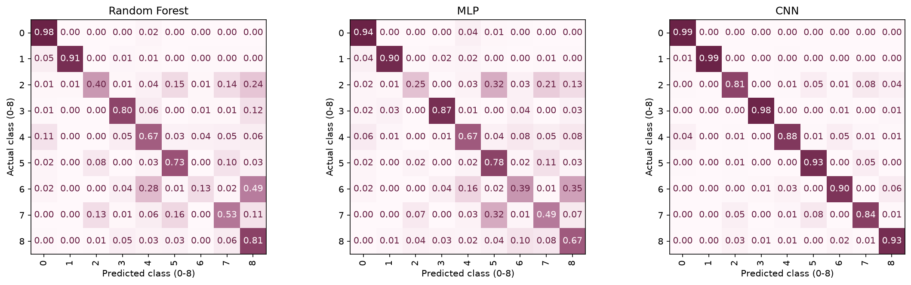

# Colorectal Cancer Tissue Classification: Random Forest vs MLP vs CNN

Comparing three supervised learning models on classifying nine types of colorectal histology tissue from H&E-stained image patches (PathMNIST).

> **Group project.** Completed as a group assignment for *Machine Learning and Data Mining* at the University of Sydney (Semester 2, 2026) by a team of 4 students. Shared here as part of my portfolio, with the team's agreement. My contributions are listed below.

## Results

| Model | Test accuracy | Macro F1 | Parameters / nodes | Final fit time |
|---|---|---|---|---|
| Random Forest | 68.3% | 0.651 | 7.7M tree nodes | 578 s |
| MLP | 67.3% | 0.655 | 1.34M params | 33 s |
| **CNN** | **91.9%** | **0.917** | **646K params** | 140 s |

The CNN beat both baselines by more than 20 points and was best on all nine classes, using half the parameters of the MLP. It also had the highest tumour recall (0.93, vs 0.81 for RF and 0.67 for MLP), which matters most in a diagnostic setting. The weaker models mostly confused normal colon mucosa with tumour epithelium: both are glandular tissue, and they differ mainly in fine local texture that only convolutions capture well.



## Dataset

- **PathMNIST** from [MedMNIST v2](https://medmnist.com/) (Yang et al., 2023), derived from the NCT-CRC-HE-100K colorectal histology dataset (Kather et al., 2019)
- 32,000 training and 8,000 test RGB patches (28×28 px), 9 tissue classes
- Mild class imbalance (1.72:1), so results report macro F1 as well as accuracy

The data files aren't included in this repo because they're too large for GitHub. To run the notebook, put `X_train.npy`, `y_train.npy`, `X_test.npy` and `y_test.npy` in a `data/` folder. You can build an equivalent dataset with the [`medmnist`](https://github.com/MedMNIST/MedMNIST) package (`PathMNIST`, size 28). Its official split differs, so the numbers will vary slightly.

## Method

1. **Leakage-safe preprocessing.** Stratified 85/15 split into development and validation sets *before* any statistics are computed. Per-channel standardisation is fitted on development data only. The test set is used exactly once.
2. **Model-specific inputs.** RF uses 2×2 average-pooled, flattened features (588). The MLP and CNN use full 28×28×3 images with random flip augmentation.
3. **Exhaustive grid search** over 261 configurations (81 RF, 72 MLP, 108 CNN), scored on a fixed validation set, with early stopping for the neural networks.
4. **Final training** of the best configurations on 27,200 images, then evaluation on the held-out test set: accuracy, macro F1, per-class F1, confusion matrices, runtime and model size.

**Best CNN:** 2 × (Conv 3×3 → MaxPool), 48 → 96 filters, Dense 128, dropout 0.2, Adam (lr 1e-3)

## Repository structure

```
├── colorectal_cancer_classification_analysis.ipynb   # full pipeline: EDA, preprocessing, tuning, evaluation
├── report.pdf                                        # written report with analysis and discussion
├── Results/                                          # search results, final metrics (CSV) and plots (PNG)
├── requirements.txt
└── README.md
```

## How to run

```bash
pip install -r requirements.txt
jupyter notebook colorectal_cancer_classification_analysis.ipynb
```

`RUN_SEARCHES = False` (in the setup cell) loads saved search results from `Results/`. Set it to `True` to re-run the full grid search, which takes about 2.5 hours on CPU.

## Tech stack

Python · NumPy · pandas · scikit-learn · Keras 3 (PyTorch backend) · Matplotlib

## My contributions

- Designed the leakage-free validation pipeline (stratified development/validation split before any statistics are computed)
- Designed the data preprocessing procedure (channel standardisation, pooled features for the Random Forest, flip augmentation)
- Wrote all sections of the report
- Provided the biological interpretation of the results, drawing on my genetics and cell biology background

## Limitations and future work

- Single validation split and seed, so differences under ~1 percentage point aren't meaningful
- 28×28 resolution loses the nuclear detail that separates normal mucosa from tumour
- Next steps: k-fold cross-validation, stain/colour augmentation, higher-resolution MedMNIST+ images (64×64), batch normalisation

These models are for educational comparison and are not clinically validated.

## Acknowledgements

- Data: Yang et al., *MedMNIST v2*, Scientific Data 2023; Kather et al., PLoS Medicine 2019
- AI tools (Claude, ChatGPT) assisted with code review, report revision and plot styling, as disclosed in the report
